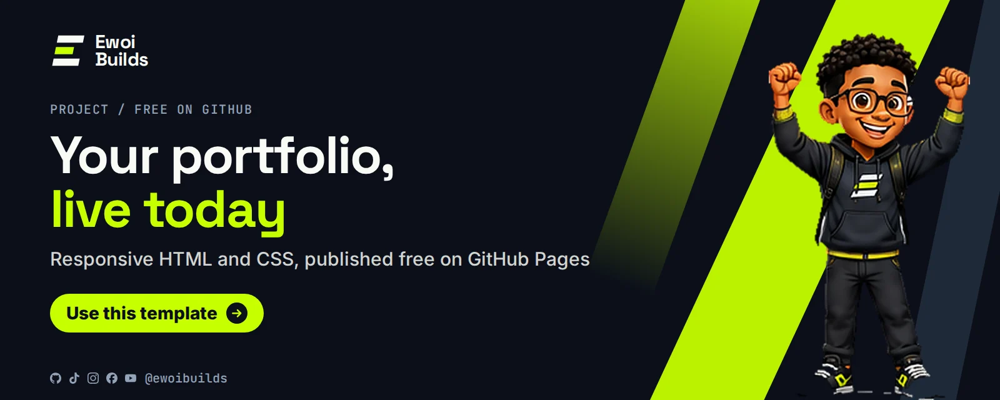

<!-- ewoi:top -->
<p align="center"></p>

<p align="center">
  <a href="https://github.com/ewoibuilds/portfolio-website/generate"><b>Use this template &rarr;</b></a> &nbsp;&middot;&nbsp;
  <a href="https://github.com/ewoibuilds"><b>All free repos</b></a> &nbsp;&middot;&nbsp;
  <a href="https://www.youtube.com/@ewoibuilds"><b>Watch the lessons</b></a>
</p>

<p align="center">
  
  
  
</p>
<!-- /ewoi:top -->

# Portfolio website

**Learn. Build. Ship.** A practical Ewoi Builds project: build a fast personal website with HTML and CSS, track it with Git and publish it free with GitHub Pages.

## What you will build

A clean, accessible, responsive one-page website with your name, what you do, your projects, your skills and how to contact you, live at `https://your-username.github.io/portfolio/`. It is the final project of the free [Developer foundations](https://ewoibuilds.com/paths/developer-foundations) path. The full guide, step by step: [Your portfolio website, live](https://ewoibuilds.com/projects/portfolio-website).

## What you need

- A laptop or desktop and a stable internet connection
- Operating system: Windows 10 or 11, macOS or Linux
- Prerequisites: [Your first commit, explained](https://ewoibuilds.com/lessons/your-first-commit-explained) and [Branches without fear](https://ewoibuilds.com/lessons/branches-without-fear), or the same Git skills
- Tools (search for each on its official site; download only from the official site):
  - Git 2.28 or newer: search for "Git official download" (on Windows, use the **Git Bash** it installs)
  - A code editor, such as Visual Studio Code: search for "VS Code official download"
  - A web browser with developer tools (Chrome, Firefox or Edge)
- A free GitHub account

## Git setup (once)

1. Set your identity: `git config --global user.name "Your Name"` and `git config --global user.email "you@example.com"` (the email you use on GitHub).
2. To push, set up an SSH key (`ssh-keygen -t ed25519 -C "you@example.com"`, add the `.pub` key on GitHub under Settings, SSH and GPG keys, test with `ssh -T git@github.com`) or a fine-grained personal access token with access to this one repository, used as your password over HTTPS. Keep the private key and the token to yourself.
3. You create your own `portfolio` repository on GitHub in step 5, empty (no README), and push your folder to it.

## Project steps

Each step ends with a commit in your own `~/ewoi-learning/portfolio` repository.

| Step | What you do | Commit | Compare with |
| --- | --- | --- | --- |
| 1 | Create the folder and run `git init` | none yet | |
| 2 and 3 | Write `index.html` and `styles.css` | `Add portfolio page and styles` | [starter/](starter/) |
| 4 | Check it at phone size in developer tools | none | |
| 5 | Create the GitHub repository, push, turn on Pages | none (push) | [Publish with GitHub Pages](#publish-with-github-pages) |
| 6 | Write `README.md` and push | `Add README` | [finished/README.md](finished/README.md) |
| 7 | Add your photo and check quality | `Add my photo` | [finished/](finished/) and [CHECKLIST.md](CHECKLIST.md) |

## Setup

Download this template once, then copy the starter into your own project folder:

```
git clone https://github.com/ewoibuilds/portfolio-website.git
mkdir -p ~/ewoi-learning/portfolio
cp -r portfolio-website/starter/. ~/ewoi-learning/portfolio/
cd ~/ewoi-learning/portfolio
git init
```

`starter/.` copies everything inside `starter`, including the hidden `images/.gitkeep` that keeps the empty `images` folder. Open `index.html` in your browser (double-click it), then replace the example name, text and links with your own. Commit:

```
git add index.html styles.css images/.gitkeep
git commit -m "Add portfolio page and styles"
```

You can also type the files from the guide yourself: the starter is the same code.

## Publish with GitHub Pages

1. On GitHub, create a new **public** repository named `portfolio`. Do not add a README, licence or `.gitignore`.
2. In `~/ewoi-learning/portfolio`, connect and push (use your own username):

   ```
   git branch -M main
   git remote add origin https://github.com/your-username/portfolio.git
   git push -u origin main
   ```

   Over HTTPS, Git asks for a password: paste your personal access token, not your GitHub password. With an SSH key, use `git@github.com:your-username/portfolio.git` instead.
3. On GitHub, open the repository's **Settings**, then **Pages**. Under "Build and deployment", set **Source** to **Deploy from a branch**, choose branch **main** and folder **/ (root)**, and click **Save**.
4. After a minute or two, the Pages settings show your address: `https://your-username.github.io/portfolio/`. Every later `git push` republishes the site by itself.

The official guide: search for "GitHub Pages quickstart" on docs.github.com.

## Check it works

- Locally: `index.html` opens in your browser with the light background, the lime button and bordered project cards.
- At phone size (developer tools, device toolbar, 320 to 375 pixels wide): nothing scrolls sideways.
- Keyboard: press Tab; the button and each link show a dark outline.
- Live: your GitHub Pages address shows the same page, with styles and photo.
- Then go through [CHECKLIST.md](CHECKLIST.md), the acceptance checklist.

## Project structure

```
portfolio-website/
├── starter/            the page after steps 2 and 3: copy this into your own repository
│   ├── images/.gitkeep keeps the empty images folder in Git
│   ├── index.html      the page structure (semantic HTML)
│   └── styles.css      the look (CSS variables, responsive heading, focus outlines)
├── finished/           an example of the end of step 7
│   ├── images/me.jpg   a placeholder image; use your own photo
│   ├── index.html      the starter plus the photo
│   ├── README.md       the README from step 6
│   └── styles.css      unchanged from the starter
└── CHECKLIST.md        the acceptance checklist
```

## Troubleshooting

| Problem | Fix |
| --- | --- |
| The page has no colours or layout | `styles.css` must sit next to `index.html`, spelled exactly as in `<link rel="stylesheet" href="styles.css">` |
| The photo does not show on GitHub Pages | Names are case-sensitive there: `images/me.jpg` is not `Images/Me.JPG`. Check the file was committed (`git ls-files`) |
| `Authentication failed` on push | Use a personal access token as the password, or an SSH key and the SSH address |
| `Repository not found` on push | A typo in the address: check it with `git remote -v`, fix it with `git remote set-url origin <address>` |
| `rejected` on the first push | The GitHub repository was created with a file such as a README. Delete it and create it again empty |
| Pages shows 404 | Wait two minutes and refresh; check Settings, Pages uses `main` and `/ (root)`, and that `index.html` is at the top of the repository, not inside a folder |
| The page scrolls sideways on a phone | Look for a fixed `width` in pixels; the starter's `img { max-width: 100%; }` and `overflow-wrap: anywhere` on links prevent the usual causes |

## Using AI on this project

Know what each part should do first, then ask for small steps. A good prompt:

> I am a beginner building a one-page portfolio with plain HTML and CSS (no frameworks), published with GitHub Pages. Here is my `styles.css`: [paste it]. On a 375 pixel phone the page scrolls sideways. Ask me questions to find the cause, explain each check in simple words, and do not rewrite my whole file.

Check every answer against the guide and the official docs (developer.mozilla.org, docs.github.com), and never paste passwords or tokens into a chat.


## Licence

MIT. See [LICENSE](LICENSE).

<!-- ewoi:end -->
## Keep going

- **Star this repo** so you can find it again, and so more learners discover it.
- **Follow [Ewoi Builds on GitHub](https://github.com/ewoibuilds)** to get the next steps and projects as they land.
- **Build it, then show it:** push your version to your own GitHub and share the link with us.
- **Stuck?** Open an issue with the "I am stuck" form. Say which step, what you ran and what you saw.
- **Lessons stay free.** If this helped, you can say thanks with [Buy me a soda](https://buymesoda.com/Rd3JwfQpNGaUXdyc4ImyIrXrENu2) or [Buy me a coffee](https://buymeacoffee.com/ewoibuilds).

Follow along: [GitHub](https://github.com/ewoibuilds), [TikTok](https://www.tiktok.com/@ewoibuilds), [Instagram](https://www.instagram.com/ewoibuilds/), [Facebook](https://www.facebook.com/profile.php?id=61596671420317), [YouTube](https://www.youtube.com/@ewoibuilds).

**Learn. Build. Ship.**
<!-- /ewoi:end -->
